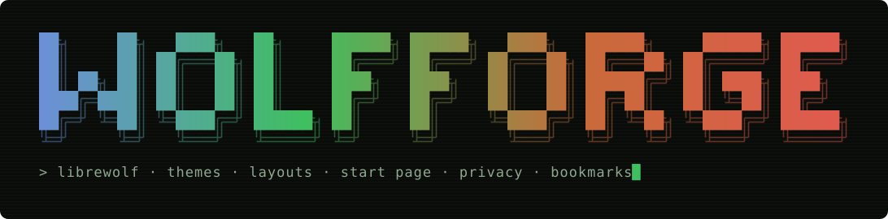
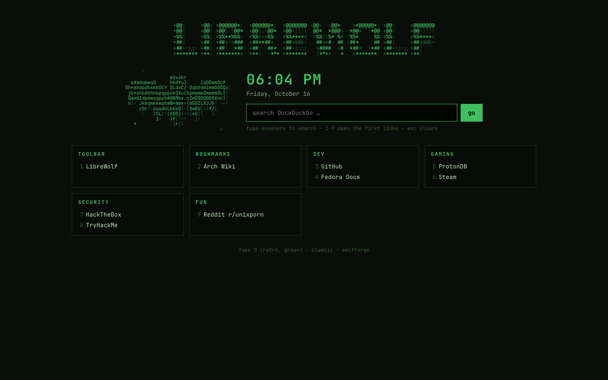
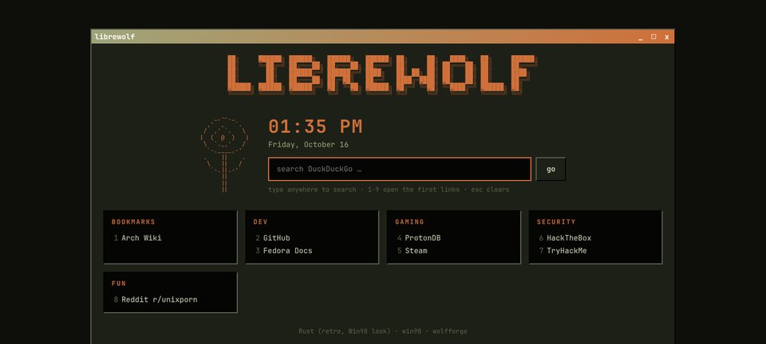
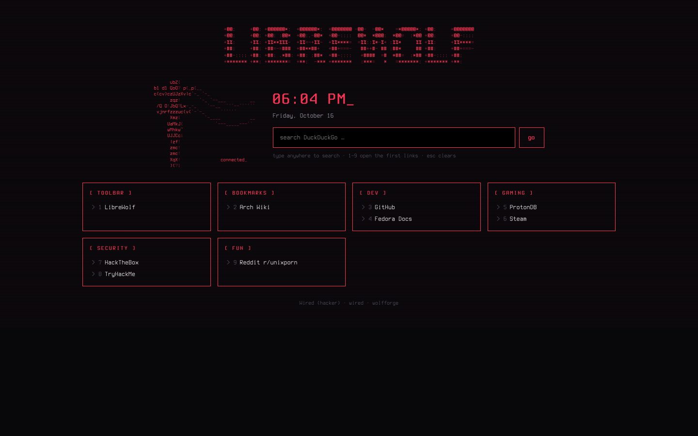
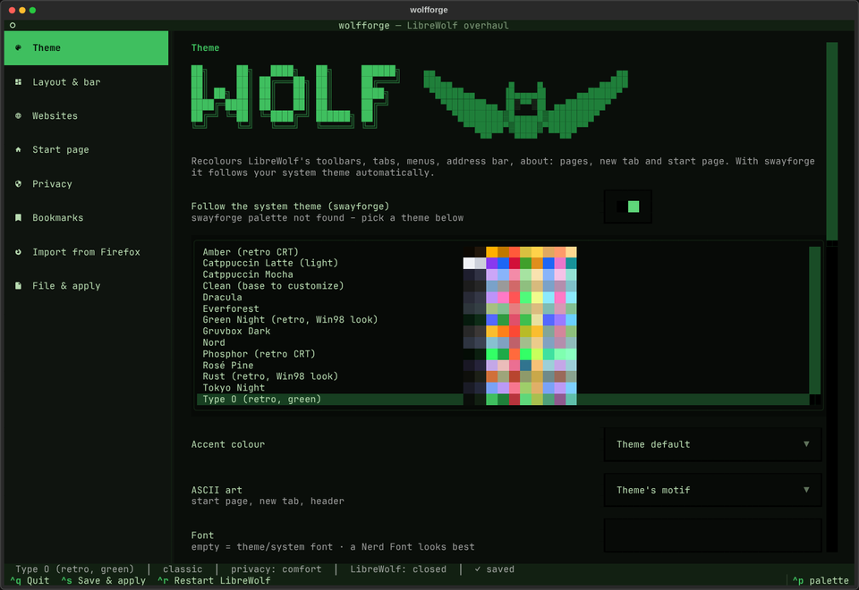

<p align="center">
  
</p>

<p align="center">
  <b>LibreWolf overhaul</b> · themes · 5 layouts · your toolbar · ASCII start page · privacy levels ·
  bookmarks · Firefox import – all in <b>one file</b>
</p>

> ⚠ **Proof of concept, written by Claude (AI) – no warranty, use at your own risk.** See [Disclaimer](#disclaimer).

wolfforge rebuilds LibreWolf's look and settings from a single file, `wolfforge.toml`, and gives you
a terminal app to edit it. With [swayforge](https://github.com/Diesumpfeule/swayforge) it follows
your system theme automatically; on its own it brings 23 themes and lets you make and save your own.

- **Theme** – toolbars, tabs, address bar, **every menu and panel** (app menu, context menus,
  downloads, extensions, bookmarks, site info), tooltips, sidebar, about: pages, new tab and start
  page in your colours and Nerd Font – on top of LibreWolf's built-in dark/light theme, so nothing
  falls back to grey. Follow swayforge, pick one, or edit colours and **save your own**.
- **Layouts** – Classic, Compact (tabs + address bar in one row), Minimal (toolbar hides until
  Ctrl+L), Classic 98 (bevels, title-bar tabs), Wired (terminal look), Cathedral (gothic), Glass
  (see-through, floating tabs), Luna XP (blue title strip, green Go), Dread (inventory-slot tabs,
  blood-red glow), Modern 11 (rounded pills). With swayforge, "take the layout from swayforge"
  picks the matching one for every swayforge layout. Tabs on top, vertical or hidden.
- **Your toolbar** – pick and order the buttons; saved in the file, restored on every machine.
- **Websites** – safe touches that can't break anything (dark-mode request, scrollbars, selection,
  caret, focus ring), **DuckDuckGo in your colours** (its official appearance settings), experimental
  theme packs for GitHub, Wikipedia and YouTube, + opt-in per-site rules (invert / dim / theme).
  Applied through the **Stylus** add-on (see below) or, if you prefer, LibreWolf's own userContent.css.
- **Start page** – shaded, animated ASCII banner and art (a glint sweeps across, sparks twinkle), clock, search, your bookmarks as tiles; type anywhere to
  search, 1–9 open links. The new-tab page gets your ASCII art too.
- **Privacy levels** – *comfort* / *librewolf* / *fortress*, plus switches for Firefox Sync,
  passwords and DRM.
- **Bookmarks in the file** – pull from LibreWolf, push back, edit by hand.
- **From Firefox** – bookmarks, add-on list (one-click install pages) and saved passwords.

## Screenshots

<table>
  <tr>
    <td><br><sub><b>Start page</b> · Type O · classic</sub></td>
    <td><br><sub><b>Start page</b> · Rust · Classic 98</sub></td>
  </tr>
  <tr>
    <td><br><sub><b>Start page</b> · Wired</sub></td>
    <td><br><sub><b>New tab</b> · ASCII art above the search</sub></td>
  </tr>
  <tr>
    <td colspan="2"><br><sub><b>The app</b> · <code>wolfforge</code></sub></td>
  </tr>
</table>

## Install

```sh
git clone https://github.com/Diesumpfeule/wolfforge.git && cd wolfforge
./install.sh
```

Installs LibreWolf (official repo) if it's missing, plus `python3-textual` and `python3-jinja2`,
then opens the app. **With swayforge:** tick *Browser → wolfforge* in the installer – done.

After changing something: `Ctrl+S` (save & apply), then `Ctrl+R` restarts LibreWolf.
Browser UI changes always need a restart – LibreWolf only reads its style files at startup.

## The one file

`~/.config/wolfforge/wolfforge.toml` holds everything. Back it up, put it in a private repo,
copy it to the next machine:

```sh
wolfforge import ~/wolfforge.toml      # takes it over and applies it
wolfforge bookmarks push               # bookmarks into LibreWolf (LibreWolf closed)
```

```toml
[general]
follow_system = true      # colours, font and art from swayforge
theme = "type-o"          # used when not following the system
layout = "compact"        # classic | compact | minimal | win98 | wired

[toolbar]
buttons = ["back", "forward", "reload", "urlbar", "downloads", "extensions"]
tabs = "top"              # top | vertical | hidden

[[sites.rules]]
domain = "example.org"
mode = "invert"           # invert | dim | theme | off

[privacy]
level = "comfort"         # comfort | librewolf | fortress
sync = false

[themes.ember]            # your saved theme
label = "Ember"
# [themes.ember.colors] …

[[bookmarks]]
title = "GitHub"
url = "https://github.com/"
folder = "Toolbar/Dev"    # Toolbar | Menu | Other + subfolders
```

## DuckDuckGo in your colours

DuckDuckGo has official appearance parameters (background, text, links, header, font). wolfforge
fills them with your theme: every search from the start page is themed automatically. For the
address bar, add it once as a search engine – the app's *Websites → Copy search URL* gives you the
link, then LibreWolf → *Settings → Search → Search Shortcuts → Add*, paste, and pick it as default.
(Search engines can only be set by you inside the browser – on purpose, so nothing can hijack them.)

## Websites through Stylus

By default the website themes (safe touches, theme packs, per-site rules) are not written into
userContent.css but into **one import file for the [Stylus](https://addons.mozilla.org/firefox/addon/styl-us/)
add-on**: `~/.local/share/wolfforge/stylus-import.json`. `wolfforge apply` keeps it up to date, and the
app's *Websites* page has a *Write Stylus import file* button (CLI: `wolfforge stylus [--to ~/Downloads]`).

1. Install Stylus in LibreWolf (once).
2. Stylus → *Manage* → *Import* → pick the file.
3. After you change the theme or a rule: write the file again and import it again. The styles have
   fixed names (`wolfforge: GitHub`, …) and ids, so importing **updates** them – no copies.

Stylus has no interface for other programs, so this import step stays manual – the theme change
itself (also via swayforge) is applied to the file automatically, only the import is yours.
Styles you removed in wolfforge (a rule, a pack) stay in Stylus until you delete them there.
Browser pages (`about:…`) and the new tab can't be styled by Stylus and keep using userContent.css.

Don't want an add-on? *Websites → Apply website themes with → userContent.css* does it all by itself.

## Privacy levels

LibreWolf already blocks telemetry, studies, Pocket, sponsored content and trackers, and ships
uBlock Origin. The levels decide how far it goes beyond that:

| Level | What it means |
|---|---|
| **comfort** (default) | LibreWolf's protection, but logins, cookies, history and open tabs survive a restart; DRM works; resist-fingerprinting off (it forces light mode and UTC) – Firefox's fingerprinting protection instead |
| **librewolf** | LibreWolf as shipped: everything cleared on exit, resist-fingerprinting on |
| **fortress** | + WebRTC off, WebGL off, letterboxing, strict referrers, HTTPS-only – some sites break |

Switches on top: **Firefox Sync** (your Firefox account: bookmarks, passwords, add-ons – the easiest
way over from Firefox), offer to save passwords, DRM.

## From Firefox

```sh
wolfforge import-firefox --passwords   # bookmarks + add-on list + saved passwords
```

Or in the app: *Import from Firefox*. Passwords are copied into the LibreWolf profile
(`logins.json` + `key4.db`) – never into the universal file. Add-ons can't be copied (LibreWolf
only installs signed add-ons from addons.mozilla.org), so wolfforge opens their pages in LibreWolf:
one click each.

## What it writes

| Where | What |
|---|---|
| `<profile>/chrome/wolfforge/chrome.css` | browser UI: colours, font, layout (generated) |
| `<profile>/chrome/wolfforge/content.css` | about: pages, new tab (generated); also website themes if the engine is *userContent.css* |
| `<profile>/chrome/userChrome.css`, `userContent.css` | **yours** – they import the generated ones first, your rules below win |
| `<profile>/user.js` | look prefs between `wolfforge begin/end` – the rest of the file is yours |
| `librewolf.overrides.cfg` | privacy prefs between `wolfforge begin/end` – the rest is yours |
| `~/.local/share/wolfforge/start.html` | the start page |
| `~/.local/share/wolfforge/stylus-import.json` | website themes for the Stylus add-on (generated) |

Delete the `wolfforge generated` line in a generated file and wolfforge leaves it alone.
Automatic backups of the universal file and replaced files: `~/.local/share/wolfforge/backups/`.

## Command line

```
wolfforge                       the app
wolfforge apply                 write everything into LibreWolf
wolfforge theme NAME | --list   switch theme (system = follow swayforge)
wolfforge layout NAME           classic | compact | minimal | win98 | wired
wolfforge bookmarks pull|push   file ⇄ LibreWolf
wolfforge import-firefox        bookmarks, add-on list (--passwords)
wolfforge export FILE / import FILE
wolfforge stylus [--to DIR]     write the Stylus import file (website themes)
wolfforge restart               restart LibreWolf
wolfforge status
```

## Notes

- The browser-UI CSS uses Firefox's own theme variables wherever possible, so it survives updates.
  If a LibreWolf update ever breaks a layout, switch to *classic* – it only recolours.
- With resist-fingerprinting on (levels *librewolf*, *fortress*) every site sees "light", so the
  dark-mode request can't work there – use per-site rules instead.
- LibreWolf as Flatpak works too (profile under `~/.var/app/io.gitlab.librewolf-community`).

## Credits

The bundled colour themes are based on these palettes – all credit for the colours goes to
their authors: [Catppuccin](https://github.com/catppuccin/catppuccin),
[Dracula](https://draculatheme.com), [Everforest](https://github.com/sainnhe/everforest),
[Gruvbox](https://github.com/morhetz/gruvbox), [Nord](https://www.nordtheme.com),
[Rosé Pine](https://rosepinetheme.com) and
[Tokyo Night](https://github.com/enkia/tokyo-night-vscode-theme).
The retro themes (Type O, Rust, Green Night, Phosphor, Amber, Wired, Clean) and all ASCII art
are original to this project; "Type O" and "Rust" are fan-made tributes and not affiliated with
anyone.

Built for [LibreWolf](https://librewolf.net) with [Textual](https://textual.textualize.io).
Not affiliated with LibreWolf or Mozilla – "Firefox" is a trademark of the Mozilla Foundation.

## Disclaimer

**This is a proof of concept** – not finished, not polished and not tested on every setup.
The code was written by **Claude**, an AI model by Anthropic, following my ideas and
instructions. It is provided **as is, without any warranty**, and I take **no responsibility**
for anything it does to your system, your data or your accounts. Read the scripts before you
run them – use at your own risk.

## Contributions

This is a personal project: pull requests and outside code are not accepted. Feel free to fork it.

## Crashes

If wolfforge crashes, it writes a report to `~/.local/share/swayforge/crashes/` and sends a
notification. The app's terminal stays open with the error until you press Enter.

## License

MIT – see [LICENSE](LICENSE).
